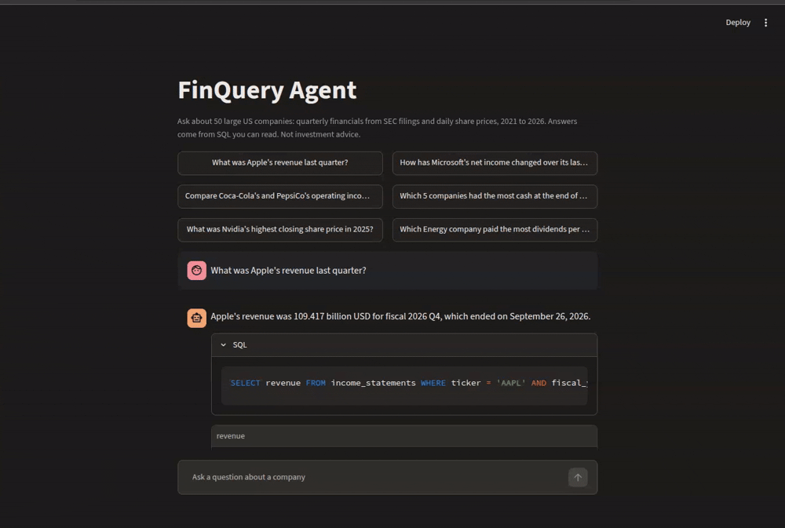
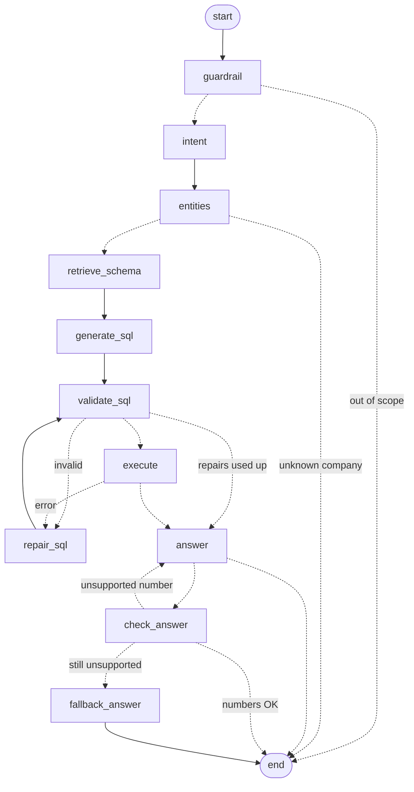

# FinQuery Agent

Ask a plain-English question about a US public company, and a LangGraph agent writes, validates
and runs the SQL over SEC EDGAR and yfinance data in PostgreSQL. You get the answer with the SQL
and the rows behind it.

[](https://github.com/mianzaman/finquery-agent/actions/workflows/ci.yml)

[](LICENSE)



## What it does

- Answers questions about 50 large US companies: lookups, trends, comparisons, rankings, and
  questions that join financial statements with share prices.
- Shows its working. Every answer comes with the SQL it ran and the rows it got back, and every
  number in the answer is checked against those rows.
- Refuses what the data cannot answer, such as investment advice, forecasts and companies
  outside the set, and never changes the data.

## Architecture



- **Guardrail, intent, entities:** one model call refuses out-of-scope questions, names the kind
  of question and finds the companies. The companies and fiscal periods are then resolved
  against the database.
- **Retrieve schema:** the question is embedded and matched against column descriptions and
  example questions in pgvector. Only the tables that matter go into the prompt.
- **Generate, validate, execute:** the model writes one `SELECT`. sqlglot checks it, and it runs
  as a read-only role. If validation or execution fails, the repair node gets the exact error
  and tries again, up to 2 times.
- **Answer, check answer:** the model writes the answer from the rows. A rule-based check traces
  every number back to the rows. An answer with an unsupported number is rewritten once, and if
  it still fails, the user gets a neutral sentence with the rows instead.

## Quickstart

You need Docker, [uv](https://docs.astral.sh/uv/) and an LLM. A free
[OpenRouter](https://openrouter.ai/keys) key works, and so does a local
[Ollama](https://ollama.com) model (see [Switching models](#switching-models)).

```bash
git clone https://github.com/mianzaman/finquery-agent.git
cd finquery-agent
cp .env.example .env    # set OPENROUTER_API_KEY, LLM_MODEL and SEC_USER_AGENT
docker compose up -d db
uv sync
uv run python -m db.migrate
uv run python -m ingestion.load_all          # SEC financials, prices, dividends, splits
uv run python -m ingestion.build_embeddings  # schema docs and examples, embedded locally
docker compose up -d
```

Open the UI at <http://localhost:8501>. The API is at <http://localhost:8000> (`POST /ask`,
`GET /health`, `GET /schema`).

SEC EDGAR asks every client for a `User-Agent` with a contact email, so set
`SEC_USER_AGENT` before you load the data. The first data load downloads about 50 SEC files
and five years of prices. Running a loader again changes nothing.

### Switching models

The model is set in `.env`. Pick one block:

```bash
# Local, free, no request limit (pull the model first: `ollama pull qwen2.5-coder:3b`)
LLM_PROVIDER=ollama
LLM_MODEL=qwen2.5-coder:3b
OLLAMA_BASE_URL=http://localhost:11434   # in docker compose: http://host.docker.internal:11434

# OpenRouter free models (50 requests a day)
LLM_PROVIDER=openrouter
OPENROUTER_API_KEY=...
LLM_MODEL=<model id ending in :free>
LLM_FALLBACK_MODELS=<optional, comma-separated :free ids>

# OpenAI
LLM_PROVIDER=openai
OPENAI_API_KEY=...
LLM_MODEL=<OpenAI model id>

# Gemini
LLM_PROVIDER=gemini
GOOGLE_API_KEY=...
LLM_MODEL=<Gemini model id>
```

## Example questions

- What was Tesla's closing share price on 30 June 2026?
- How has Nvidia's quarterly revenue changed over its last 8 quarters?
- Compare Visa's and Mastercard's net income in fiscal 2025...
- Which 5 companies had the highest total revenue in fiscal 2025?
- What was Apple's price-to-earnings ratio at the end of fiscal 2025, using the closing price on
  the last trading day of the fiscal year and fiscal 2025 diluted EPS?
- Which companies grew revenue in fiscal 2025 compared with fiscal 2024 but saw their share price
  fall from the first to the last trading day of 2025?

## Evaluation

The eval set (`evals/questions.jsonl`) has 30 questions: 26 answerable ones in five categories,
each with gold SQL, and 4 that must be refused. A question passes when the system's rows match
the gold rows. The **baseline** is a single prompt with the full schema and no agent.

```bash
uv run python -m evals.run_eval --system baseline
uv run python -m evals.run_eval --system agent
uv run python -m evals.run_eval --compare       # latest baseline and agent runs side by side
```

Results on OpenRouter `nvidia/nemotron-3.5-super-vl:free`, cost $0:

| | Baseline | Agent |
|---|---|---|
| Questions | 30 | 10-question sample, 2 per category |
| Execution accuracy | 88.5% (23 of 26) | 100% (10 of 10) |
| Same 10 questions | 8 of 10 | 10 of 10 |
| Valid SQL | 100% | 100% |
| Faithfulness (numbers traced to rows) | n/a | 100% (10 of 10) |
| Repairs needed | n/a | 0 |
| Refusals | 100% (4 of 4) | 100% (4 of 4, separate run) |
| Latency p50 / p95 | 6.3 s / 23.5 s | 18.2 s / 39.2 s |
| Tokens per question | 1,835 | 4,618 |

Sources: `evals/results/2026-11-15_0537_baseline.json` (accuracy),
`2026-11-15_0524_baseline.json` (baseline latency and tokens; the later run used cached replies),
`2026-11-16_1649_agent.json` (agent) and `2026-11-15_1809_agent.json` (refusals). The agent was
run on a 10-question sample to fit the free tier's 50 requests a day, so these numbers are a
sample, not a full comparison.

<!-- Ablation table goes here once the eval set has 60+ questions. -->

## Safety

- **Read-only role:** agent SQL runs as `agent_reader`, which can only `SELECT` from the data
  tables, inside a read-only transaction.
- **sqlglot validation:** every query is parsed before it reaches the database. It must be
  exactly one read-only query, on the allowed tables only, calling only functions on an
  allow-list. That blocks sleeping, taking locks, reading server settings, turning off the
  timeout and running SQL hidden in a string. The query is rebuilt with a 500-row cap, and
  `EXPLAIN` catches unknown columns before anything runs.
- **Timeouts:** each query has a 5-second statement timeout, set on the role and again in each
  transaction. The API also limits requests per client and questions answered at once.
- **Faithfulness check:** a rule-based check, with no model, traces every number in the answer
  to the rows, allowing for rounding, percentages and simple differences or ratios. Unsupported
  numbers trigger a rewrite and then a neutral fallback.

## Design decisions

### Why LangGraph

A text-to-SQL agent is not a straight line. A question can be refused, a query can fail
validation or execution and loop back for repair, and an answer can be rejected and rewritten.
LangGraph makes those branches explicit: each step is a node with one job, routing lives in
small functions in `graph.py`, and one typed `AgentState` travels between the nodes. That made
every route (success, repair, retry limit, refusal) testable with fake nodes before any model
was involved, and it keeps the number of model calls visible: about three per question, which
matters on a free tier of 50 requests a day. A single prompt chain would hide the loops inside
retries, and a framework that lets the model pick its own steps is the opposite of what a
system that writes database queries needs.

### Why pgvector

The retrieval corpus is small: a description of every table and column, and 27 worked
examples. Keeping their embeddings in the same PostgreSQL as the data (pgvector, HNSW index)
means one service to run, one migration system and retrieval queries that are plain SQL. A
separate vector database would add a dependency without adding anything at this size.
Embeddings come from a local model (fastembed `bge-small-en-v1.5`, 384 dimensions), so building
and searching the index costs no API requests. The column is sized so that OpenAI's
`text-embedding-3-small` at 384 dimensions could replace it without a migration.

Retrieval itself is what separates the agent from the baseline. The baseline puts the whole
schema in every prompt. The agent sends only the tables that matter plus the three closest
examples, and those examples teach the rules a model cannot guess about this data: sum four
quarters for a fiscal year, take the fiscal Q4 row for a year-end balance sheet, use
split-adjusted EPS for trends.

### Why a repair loop

Generated SQL fails in predictable, fixable ways: an unknown column, a function the validator
does not allow, a type mismatch. The repair node gets the failed SQL and the exact error from
sqlglot or Postgres and tries again. Repairs are capped at 2, shared by validation and database
errors and checked before each attempt, so a question costs at most three SQL generations and
can never loop. After the cap the agent answers with an error note instead of guessing. In the
hosted sample no repair was needed; small local models needed it often, and one local run showed
a repair returning the same SQL twice, so stopping early in that case is a planned improvement.

### Why read-only SQL

The model's output is untrusted input that happens to be SQL, so safety does not depend on the
prompt. There are three independent layers:

1. **Validation:** sqlglot parses every query and accepts only a single read-only statement
   over an allow-list of 8 tables and about 85 functions. Allow-lists rather than deny-lists
   mean anything new is rejected by default.
2. **Rebuild and dry run:** the query is rebuilt with a 500-row cap, validated again and
   checked with `EXPLAIN` before it runs.
3. **Database role:** it runs as `agent_reader`, which can only `SELECT` from the data tables,
   inside a read-only transaction with a 5-second statement timeout.

If one layer has a gap, the other two still hold.

### Why values are stored as first filed

Companies restate history. After a spin-off or a stock split, later filings recast earlier
quarters, but only the ones they show. Keeping the latest value for each quarter mixed bases
within one series: Honeywell's 2025 revenue had one quarter at half the size of its neighbours.
So every value is stored as the original 10-Q or 10-K reported it, a quarter that would have to
be derived across a restatement is left empty with a warning, and EPS gets a separate
split-adjusted view for trends and price ratios. The trade-off is that later corrections are
ignored, and a series can still step where the company itself changed shape.

### Why the faithfulness check uses rules, not a model

A model can write a fluent answer around a wrong number. Asking a second model to grade the
first costs another request and can fail the same way. Instead, a deterministic check traces
every number in the answer back to the rows, allowing for rounding, percentages and simple
differences or ratios. An unsupported number triggers one rewrite that names it; if the answer
still fails, the user gets a neutral sentence and the rows. The check cannot tell when a real
number is attached to the wrong company or period; that limit is listed below.

### Why the model is a setting

The project was built on free tiers: a local Ollama model for development and free OpenRouter
models for hosted runs. The provider and model are chosen in `.env`, and only `app/llm.py` names
one, so moving to a paid model is a configuration change. Every results file records the
provider and model, and the eval refuses to compare runs that used different models.

## Limitations and next steps

- **Scope:** 50 companies, quarterly financials from 2021 to 2026 Q3, and daily prices from
  November 2021. No real-time prices and no companies outside the set.
- **Small eval:** 30 questions, and the agent was scored on a 10-question sample. The next step
  is growing the set to 60+ questions with harder cases, then an ablation study that measures
  each part of the graph.
- **Faithfulness check limits:** it catches invented numbers, but not a real number given to the
  wrong company or period.
- **Small local models** make more mistakes. In local runs, wrong scale ("30.71 million" for
  billions) was the most common one. Use them for trying the pipeline.
- **Planned:** tracing, clarifying questions, follow-up memory, chart output and an MCP tool.

## Data and disclaimer

Financial statements come from [SEC EDGAR](https://www.sec.gov/edgar) (XBRL company facts), and
prices, dividends and splits from Yahoo Finance via [yfinance](https://github.com/ranaroussi/yfinance).
Data may contain errors.

**This is not investment advice.** FinQuery is a portfolio project for exploring text-to-SQL.

## License

[MIT](LICENSE)
